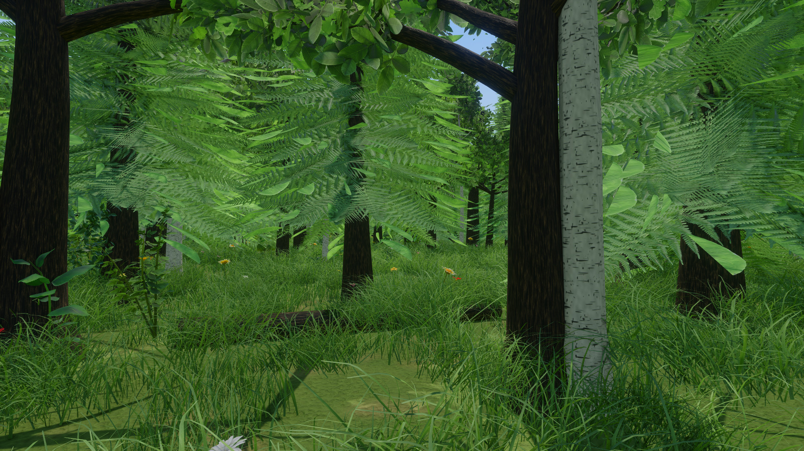
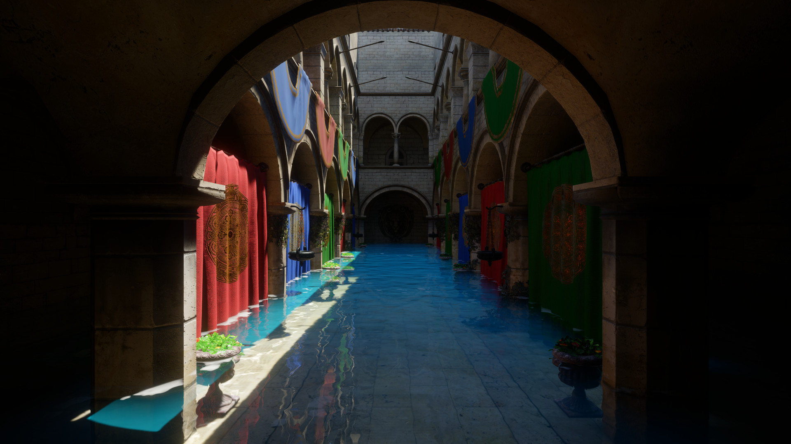

# Falcon Engine

Falcon is a GPU-driven game engine with its own editor, written in C++20 on SDL3 and SDL_GPU,
with Slang shaders, games scripted in C#, and an editor built from HTML pages. It runs on Windows
(Direct3D 12 or Vulkan), Linux (Vulkan) and macOS on Apple silicon (Metal).

> **Status:** early and moving fast. Builds for Windows, Linux and macOS are on the
> [Releases](https://github.com/Tebarem/falcon/releases) page. Windows gets the most testing; the
> Linux build is checked on software Vulkan, and the macOS build has had little use on real Macs
> so far.


*A forest grown by the terrain's scatter layers: trees, ferns, grass and flowers, 20k instances on
screen. GPU 5.6 ms a frame.*


*Sponza flooded with the Tropical lagoon water preset, lit by the probe GI. GPU 5.3 ms a frame.*

Both at 1920×1080 with FSR's native anti-aliasing, on a Radeon RX 9060 XT (Direct3D 12).

## Features

- **Rendering:** a GPU-driven visibility buffer with cluster LODs and GPU culling, virtual
  texturing, clustered lighting for thousands of lights, virtual shadow maps, probe-based global
  illumination traced through a compute-shader BVH, screen-space and traced reflections, and
  post-processing (GTAO, bloom, auto exposure, TAA, FSR and DLSS upscaling on Direct3D 12).
- **Editor:** a project launcher, scene editing with gizmos, an asset browser with a shared
  material library, an animation graph editor, a profiler and live-reloading UI.
- **Level design:** ProBuilder-style meshes, walls, rooms and openings, live boolean cuts, trim
  sheets, layered surfaces, wear and tear, splines and navigation meshes.
- **Terrain and water:** streamed heightfields up to 8×8 km with sculpting and painting; lakes,
  rivers and oceans with buoyancy.
- **Animation:** Esoterica's animation graph runtime, GPU skinning, inverse kinematics and rigid
  node animation.
- **Physics and audio:** Box3D physics with cooked collision; a mixer spatialised by Steam Audio,
  with occlusion, reverb, physics sounds and baked acoustics.
- **Scripting:** C# games with hot reload in the editor (CoreCLR) and NativeAOT in shipped builds.
- **Networking and Steam:** a deterministic simulation (the same bits on every machine) as the
  base for multiplayer, and the full Steamworks API from C#.
- **Particles and decals**, built from components.

## Building

```bash
git clone --recurse-submodules --shallow-submodules https://github.com/Tebarem/falcon.git
cd falcon
```

Windows (Visual Studio 2022, CMake 3.25+, Ninja, the .NET 10 SDK and the
[Slang](https://github.com/shader-slang/slang/releases) release):

```powershell
./build.ps1 -Preset release
./build/release/bin/falcon.exe
```

Linux and macOS (CMake 3.25+, Ninja, a C++20 compiler and the .NET 10 SDK; `build.sh` fetches
Slang and CEF):

```bash
./build.sh
./build/linux/bin/falcon --help     # build/macos on a Mac
```

`falcon` with no arguments opens the launcher, where you create or open a project. The optional
SDKs (Steam Audio, Steamworks, FSR, DLSS, MsQuic), presets and tests are in
[docs/building.md](docs/building.md).

## Documentation

| | |
|---|---|
| [Build](docs/building.md) | requirements, optional SDKs, presets, tests, CI |
| [Projects, scenes and the editor](docs/editor.md) | the launcher, projects, cooked scenes, the editor and the HTML UI |
| [Rendering](docs/rendering.md) | the visibility buffer, virtual texturing, lights and shadows, GI, ray tracing, reflections, post-processing |
| [Physics](docs/physics.md) | Box3D, cooked collision, dynamic bodies |
| [Terrain](docs/terrain.md) | streaming, materials, sculpting and painting |
| [Water](docs/water.md) | water bodies, waves, buoyancy, underwater |
| [Audio](docs/audio.md) | the mixer, Steam Audio, acoustics |
| [C# scripting](docs/scripting.md) | the API, hot reload, NativeAOT |
| [Networking](docs/networking.md) | the deterministic simulation |
| [Steam](docs/steam.md) | Steamworks from C#, publishing |
| [Level design](docs/level-design.md) | the level tools |
| [Animation](docs/animation.md) | graphs, IK, rigid node animation |
| [Particles and decals](docs/particles-decals.md) | effects components |
| [Profiler and freeze reports](docs/debugging.md) | the Profiler tab, freeze reports |
| [Runtime flags](docs/runtime-flags.md) | every command-line flag |
| [SDL_GPU notes](docs/sdl_gpu_notes.md) | SDL_GPU behaviour the renderer relies on |

## Layout

- `engine/` – runtime (core, gpu, render, anim, physics, scene, script, terrain, water, audio, ui, editor, app) and `shaders/*.slang`
- `ui/` – HTML bundles: `launcher` (project selector), `editor` (editor shell), `hud` (Sandbox HUD); copied to `bin/falcon-ui/`
- `samples/graphs/` – animation graphs (JSON)
- `managed/` – C# scripting API (`Falcon.Engine`) and the `Sandbox` sample game
- `tools/schemagen/` – shared ECS component schema → C++ / C#
- `tools/shaderc/` – build-time Slang compiler + SDL_GPU binding validator
- `tools/cook/` – glTF → `.fpak` cooker, `falcon cook` (format: `engine/assets/fpak_format.h`)
- `tools/imgdiff/` – image comparison for the capture tests
- `tools/wavdiff/` – WAV checks and comparison for the audio tests
- `runtime/` – `falcon.exe`: dispatches to the engine, the cooker or CEF's helper
- `external/` – pinned submodules
- `content/` – the CC0 material library and prototype textures shipped in `bin/content/`
- `cmake/`, `scripts/` – build modules, patches to submodules, SDK fetch and packaging scripts
- `docs/` – the documentation

## License

Falcon's own code, shaders, UI and tools are under the MIT license (`LICENSE`). What it builds
with keeps its own license:
- cef-lite (the editor's and in-game HTML UI) is GPL-3.0, so a build with the UI is
  GPL-3.0 as a whole. `-DFALCON_UI=OFF` builds the engine without it.
- The submodules in `external/` (SDL, flecs, Box3D, meshoptimizer, Manifold, Recast/Detour and
  the rest) carry their licenses in their folders.
- `content/library` (Poly Haven) and `content/prototype` (Kenney) are CC0: their `License.txt`.
- SDKs fetched at build time are not part of this repository and come under their vendors'
  terms: CEF (BSD), Steam Audio, the Steamworks SDK (needs a partner login), AMD FidelityFX
  (FSR) and NVIDIA DLSS (only linked into the separate `falcon_dlss` plugin).
